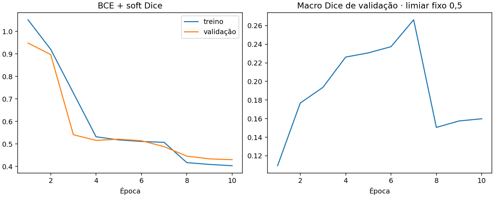
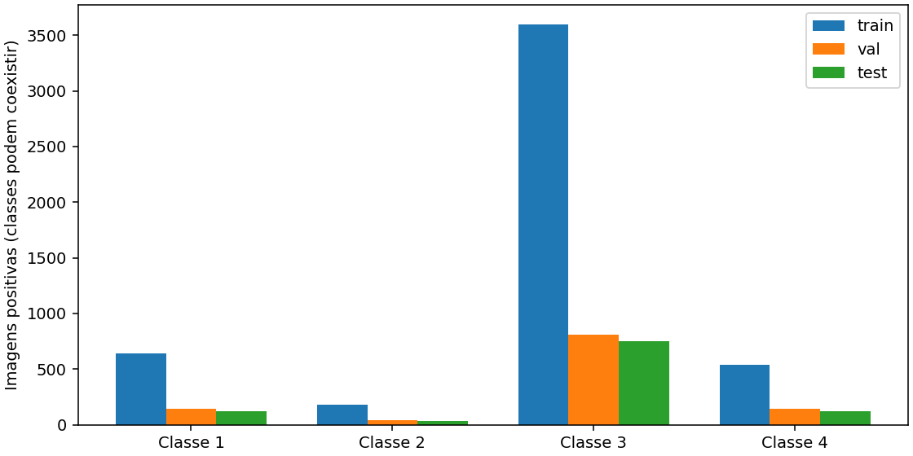

# Resultados reais — Severstal

Treinamento executado no Kaggle com **12.568 imagens reais**, U-Net em PyTorch e GPU T4.
O conjunto público anotado foi dividido em **8.798 imagens de treino**, **1.885 de validação**
e **1.885 de teste reservado**. Não foram usadas as imagens oficiais sem rótulos da competição
para medir qualidade.

Foram concluídas **10 épocas**. O checkpoint foi selecionado pelo Dice de validação na
**época 7**, com macro Dice **0,2663**. No teste reservado, macro Dice **0,2443**.
Treinamento com batch 8, AdamW, learning rate 0,001, seed 42, AMP CUDA e dois workers.
A etapa de treinamento e validação levou aproximadamente **24,4 minutos**;
a execução completa, incluindo preparação e avaliação, levou cerca de 28 minutos.

| Classe | Imagens positivas no teste | Dice global | IoU global | Recall por pixel |
|---|---:|---:|---:|---:|
| 1 | 118 | 0.0000 | 0.0000 | 0.0000 |
| 2 | 32 | 0.0000 | 0.0000 | 0.0000 |
| 3 | 747 | 0.6141 | 0.4431 | 0.5435 |
| 4 | 122 | 0.3631 | 0.2218 | 0.3399 |

## Interpretação e limitações

O modelo **não produziu pixels positivos para as classes 1 e 2** no teste com limiar 0,5.
Isso resulta em recall e Dice zero nessas classes, e precisão indefinida (null).
O baseline ainda não cobre adequadamente as quatro classes de defeitos.
A classe 3 obteve Dice 0,6141 e a classe 4, 0,3631.

Há desbalanceamento entre classes: no treino, a classe 2 aparece em apenas 178 imagens,
enquanto a classe 3 aparece em 3.594. Esse é um fator a investigar, não uma causa demonstrada
por este experimento. A resolução foi reduzida de 256 × 1600 para **128 × 800**, o que também
pode prejudicar defeitos pequenos. As métricas não equivalem ao placar oficial da competição.

A loss de validação continuou caindo após a época 7, enquanto o Dice piorou; por isso,
o último checkpoint não foi usado como se fosse o melhor. O conjunto de teste não participou
da seleção do modelo ou do limiar.

Próximas hipóteses para avaliar na validação: amostragem e pesos por classe,
resolução maior, encoder pré-treinado e limiares por classe. Não houve ajuste usando
os resultados do teste. Uma nova rodada de desenvolvimento exigirá cuidado para manter
uma avaliação final independente.

## Evidências

- [Execução publicada no Kaggle](https://www.kaggle.com/code/flaviagg/steelvision-steel-defects-with-pytorch-u-net?scriptVersionId=365761846)
- [Métricas completas](metrics.json)
- [Histórico das dez épocas](history.json)
- [Configuração e ambiente reais](run.json)
- [Distribuição dos dados](data_summary.json)
- [Proveniência da execução](../real_run_status.json)

Os arquivos completos, checkpoint e exemplos visuais estão nos Outputs do notebook Kaggle.
Esta pasta pública contém apenas métricas e gráficos agregados; não redistribui imagens
ou máscaras da competição. As evidências sintéticas anteriores foram mantidas separadamente
em `docs/synthetic_demo/` e não representam estes resultados.
