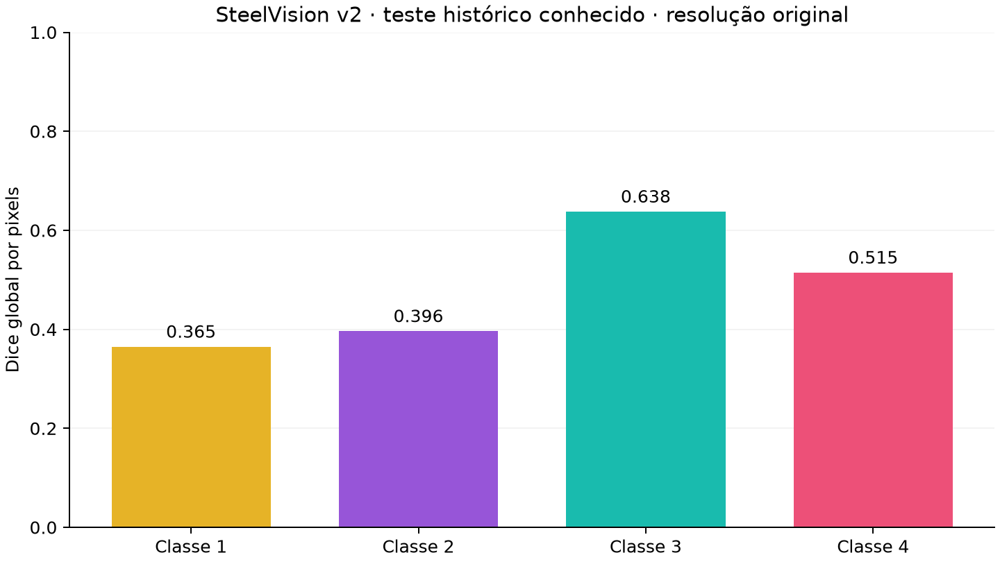
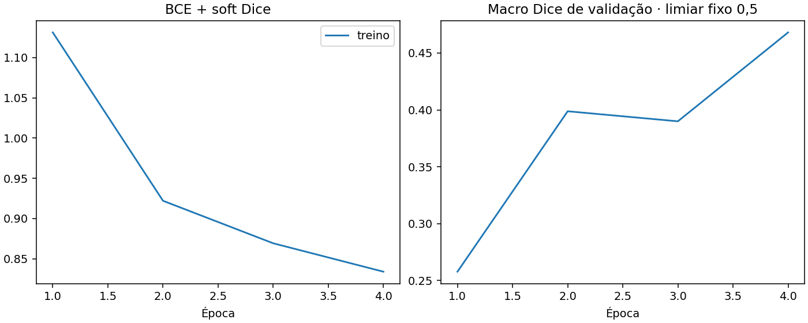

# SteelVision v2 — execução real concluída

Execução Kaggle de 7 de novembro de 2026. ResNet18 ImageNet congelado + decoder U-Net, patches nativos, amostragem balanceada e BCE ponderada + Dice. Não é uma implantação industrial.

[Notebook executado, versão 5](https://www.kaggle.com/code/flaviagg/steelvision-steel-defects-with-pytorch-u-net?scriptVersionId=366705948) · [Código exato](https://github.com/flaviagaia/industrial-vision-mlops/tree/95555ae)

## Resultado

Quatro épocas concluídas. Melhor checkpoint: época 4; macro Dice de validação com limiar 0,5: **0.468095**. Após calibração somente na validação: **0.510156** (estimativa otimista no próprio conjunto de ajuste).

Macro Dice no teste histórico conhecido, com limiares congelados: **0.478522**.

| Classe | Limiar | Dice | Precisão por pixel | Recall por pixel | Falso positivo em imagens negativas |
|---|---:|---:|---:|---:|---:|
| 1 | 0.90 | 0.3650 | 0.3262 | 0.4143 | 26.32% |
| 2 | 0.90 | 0.3964 | 0.3693 | 0.4279 | 6.48% |
| 3 | 0.85 | 0.6379 | 0.6055 | 0.6740 | 47.72% |
| 4 | 0.95 | 0.5148 | 0.4049 | 0.7064 | 11.12% |

## Protocolo e evidências

- 12.568 imagens originais de 256 × 1.600: treino 8.798, validação 1.885, teste histórico 1.885. Manifesto idêntico ao baseline, confirmado por SHA-256. Duplicatas exatas não atravessam os conjuntos.
- Treino: batch 8, patches 256 × 400, seed 42, AdamW 0,0003, clipping 1,0, AMP CUDA. Apenas o decoder aprende; encoder e estatísticas BatchNorm permanecem congelados.
- Melhor checkpoint selecionado na validação nativa com limiar fixo 0,5. Busca por classe em 0,05–0,95 exclusivamente na validação. Teste executado após congelar esses limiares.
- Validação, calibração, teste e inferência isolada compartilham o mesmo mosaico nativo. As máscaras finais preservam 256 × 1.600.
- Treino + validações: 11.22 min. Notebook completo: 18 min 26 s; ambiente Kaggle com GPU T4, PyTorch 2.11.0+cu130. Isso não é benchmark de latência de inferência.
- `last.pt` contém modelo, otimizador, GradScaler, RNGs e histórico. O artefato baixado passou em teste de integridade ZIP, carregamento seguro e verificação de pesos finitos; hash do checkpoint calibrado confere com o relatório.
- Código: 28 testes locais aprovados e CI aprovado em Python 3.11/3.12. Retomada equivalente foi testada em CPU; não se afirma equivalência bit a bit entre GPUs/versões.

## Incidente observado

A versão 4 (366704675), com fine-tuning do encoder sob FP16, foi interrompida na primeira época por loss não finita. Não produziu métricas finais. A versão 5 congela o encoder, limita a norma dos gradientes e rejeita logits não finitos na inferência. As quatro épocas reais concluíram após a correção. O efeito isolado de cada mudança não foi medido.

## Limitações e próximos experimentos

O teste é histórico e já havia sido examinado no baseline. Estes resultados não demonstram generalização externa. O baseline calculava Dice em 128 × 800; a v2 mede 256 × 1.600. Não calcular ganho percentual direto entre esses números sem reavaliar ambos no mesmo protocolo.

As classes 1 e 2 apresentam segmentação não nula nesta execução. Isso não isola o efeito de balanceamento, resolução, pesos ou encoder: o candidato combina essas mudanças. As ablações do protocolo permanecem propostas, não executadas.

Ainda há falsos positivos relevantes: na classe 3, 47,72% das imagens negativas têm pelo menos um pixel predito. Essa definição não exige tamanho mínimo de região e não equivale a uma taxa de alarme industrial. A classe 4 selecionou o limite superior da grade de limiares. Suporte da classe 2 no teste: apenas 32 imagens positivas. Próximos ajustes devem usar validação; não retunar pelo teste histórico.

Uma validação industrial exige novos lotes/câmeras/períodos, critérios de área mínima e custos de falso positivo/falso negativo definidos com o processo. ONNX, monitoramento de incidentes e API/MLflow seguem nos laboratórios 2–4.

## Arquivos publicados

Este diretório contém apenas métricas e gráficos agregados, configuração, estatísticas agregadas do treino e calibração. Imagens, máscaras, RLE por imagem e checkpoints ficam no Kaggle/local, sujeitos às regras Severstal.
